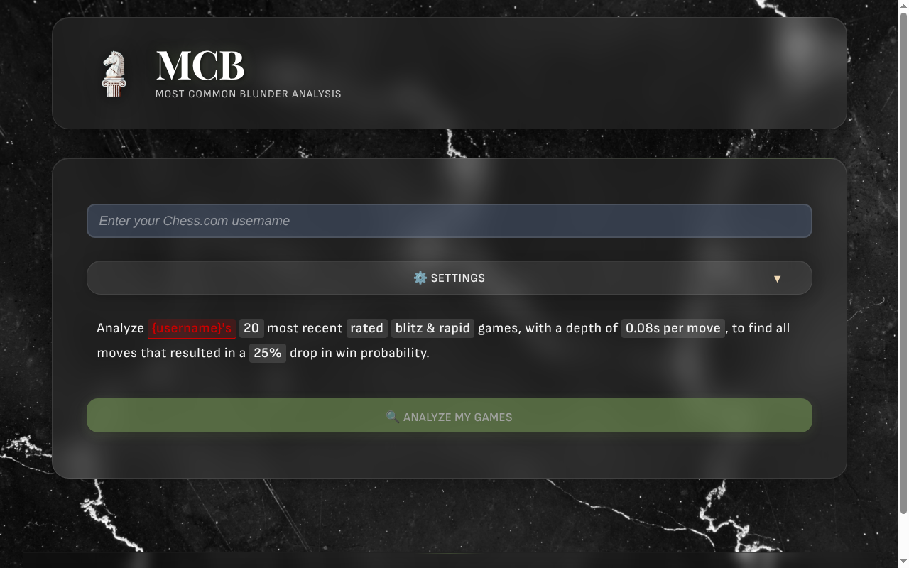

# MCB - Most Common Blunder

**Discover your chess weaknesses and improve your game**

Live at **[mcb.ryo-nd.com](https://mcb.ryo-nd.com)**.

## What is MCB?

MCB (Most Common Blunder) is a chess analysis tool that helps players identify their most frequent mistakes and improve their game. By analyzing your Chess.com games with the Stockfish engine, MCB provides detailed insights into your blunders, categorizes them by type, and shows you exactly where you need to focus your training.

## Features

### **Comprehensive Game Analysis**

- **Chess.com Integration**: Automatically fetch and analyze games from your Chess.com profile
- **Stockfish Engine**: Every move the player makes is checked by Stockfish
- **Batch Analysis**: Analyze up to 100 of your most recent games per run (200 games per player per day)

### **Detailed Blunder Breakdown**

- **Most Common Blunder**: Discover your #1 chess weakness
- **Game-by-Game Breakdown**: See specific blunders in each analyzed game
- **Move-by-Move Analysis**: Understand exactly where and why blunders occurred

### **Customizable Analysis Settings**

- **Game Type Filtering**: Choose between blitz, rapid, bullet, or classical games
- **Rating Filters**: Analyze rated or unrated games
- **Result Filtering**: Focus on wins, losses, or both
- **Adjustable Threshold**: Choose how large a drop in win probability (5 to 40 percent) counts as a blunder
- **Analysis Depth**: Choose 0.08, 0.15 or 0.3 seconds of engine time per move

### **User-Friendly Interface**

- **Real-time Progress**: Live updates during analysis with detailed logs
- **Responsive UI**: Works in desktop and mobile browsers
- **Interactive Results**: Click through games and blunders with ease

## Tech Stack

**Backend:**

- **Flask** - Web framework
- **Python-Chess** - Chess game logic and PGN processing
- **Stockfish** - Chess engine for analysis
- **Requests** - Chess.com API integration

**Frontend:**

- **React 19** - Modern UI framework
- **Vite** - Fast build tool and development server
- **Context API** - State management
- **CSS3** - Custom responsive styling

## Try It Live

**Ready to discover your chess blunders?**

_Just enter your Chess.com username and start analyzing!_

## How to Use

1. **Enter Your Chess.com Username**: Input your Chess.com username in the analysis form
2. **Configure Settings**: Choose the number of games, game types, and analysis depth
3. **Start Analysis**: Click "Analyze Games" and wait for the real-time analysis to complete
4. **Review Results**: Explore your most common blunder, detailed breakdowns, and game-specific insights
5. **Improve Your Game**: Use the insights to focus your chess training on your biggest weaknesses

## Architecture

MCB is a Flask API with a React front end:

- **`app.py`** / **`routes.py`** - Flask application, API routes, rate limiting and security headers
- **`analysis_service.py`** - Core analysis logic, with optional parallel workers (off by default)
- **`engines/stockfish_pool.py`** - Engine pool management for concurrent analysis
- **`mcb-react/src`** - Modern React frontend with component-based architecture

## Acknowledgments

- **Stockfish Team** - For the incredible chess engine that powers our analysis
- **Chess.com** - For providing the public API that enables game fetching
- **Python-Chess Library** - For excellent chess game processing capabilities

## Analytics

Set `CF_WEB_ANALYTICS_TOKEN` to a Cloudflare Web Analytics site token and the server adds Cloudflare's privacy-first beacon to the page (and allows it in the Content Security Policy). Leave it unset and nothing is added.

## DEV NOTE
Currently, I am working on making MCB's analysis faster. As it stands, a "fast" analysis may take 1-2 minutes. Please be patient as I work on making the application more efficient. Thank you!

---

**Improve your chess, one blunder at a time!** 

